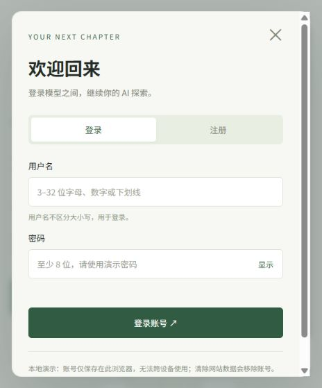

# 模型之间 · AI 大模型探索指南

介绍 ChatGPT、DeepSeek、Grok、Claude、Gemini、Qwen、Kimi 和豆包的中文静态网站，提供官方访问入口。

## 功能

- 模型介绍、搜索、按用途筛选及详情弹窗。
- 响应式布局，适配电脑与手机。
- 本地注册、登录、退出及刷新后保持当前标签页的登录状态。

## 本地运行

无需安装前端依赖。在本目录执行：

```sh
python -m http.server 8765 --bind 127.0.0.1
```

然后访问 http://127.0.0.1:8765/ 。账号演示功能需要支持 Web Crypto 的现代浏览器，建议使用 localhost 或 HTTPS。

## 文件

- `index.html`：页面和弹窗。
- `style.css`：样式和响应式布局。
- `app.js`：模型内容、搜索和筛选。
- `auth.js`：浏览器本地账号演示逻辑。
- `login-preview.png`：登录界面预览。

## 账号功能说明

这是静态演示，尚未接入服务器认证。账号保存在当前浏览器的 localStorage 中，密码以随机盐值和 PBKDF2-SHA-256 摘要保存；登录状态存于 sessionStorage，最多保留 12 小时。清除网站数据会移除账号，账号无法跨设备使用。客户端状态不能用来保护服务器资源，请勿使用真实或常用密码。正式上线使用账号体系需要接入后端认证服务。

## 预览


